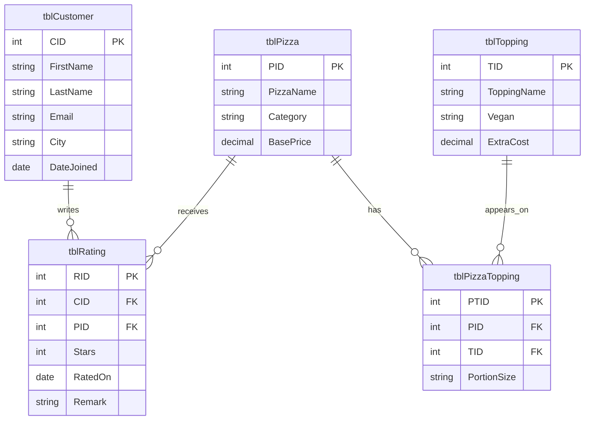

# SliceDB: Entity-Relationship Diagram
**Designed by:** Carter Atkins

## My design decisions
- (a) tblPizzaTopping exists as its own table because a pizza has many toppings and a topping is on many pizzas, and a many-to-many link can only be stored as one row per pizza-and-topping pair.
- (b) It has its own key PTID so every pizza-topping row can be identified and referenced by itself, instead of relying on a combination of two columns.
- (c) Remark allows NULL because a customer can leave a star rating without writing anything, and an empty remark should not block the rating.
- (d) My wireframe shows a "Signed in as" customer in region 1, but tblCustomer has no password or login column, so the tables cannot store sign-in details. Also, nothing enforces Stars to be between 1 and 5.
